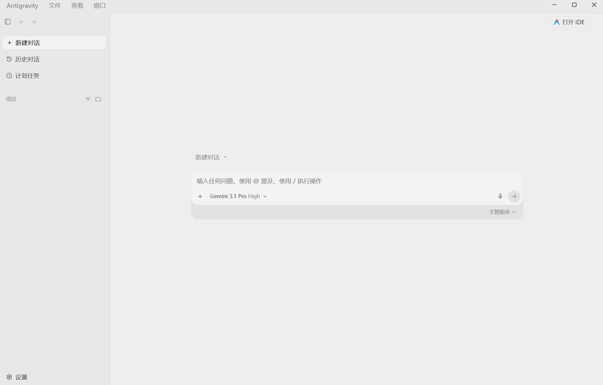

# Antigravity-zh-CN

<div align="center">

**🌏 [English](README_EN.md) | 简体中文**

一个为 Google Antigravity 桌面端提供完整中文界面的开源汉化补丁

[](https://opensource.org/licenses/MIT)
[](https://www.python.org/downloads/)
[](https://www.microsoft.com/windows)

</div>

---

## 📖 项目简介

**Antigravity 一键汉化补丁** - 为 Google Antigravity 桌面端提供完整的中文界面支持（基于 [MIMICTE/Antigravity-zh-CN](https://github.com/MIMICTE/Antigravity-zh-CN) 持续适配维护，遵循 MIT 协议）：
- 🧭 **跨机动态探测**：自动读取 `ANTIGRAVITY_APP_DIR`、Windows 安装注册表与常见目录定位桌面端路径，不依赖固定盘符；
- 🔄 **适配 Antigravity 2.33+/2.34+**：完整保留官方自动更新通道与扩展插件兼容性；
- 🐋 **无缝联动大肥鱼管家**：可在大肥鱼管家「反重力切号」与「工具更新」标签页一键克隆、拉取词典更新、执行汉化或还原英文。

## ✨ 核心特性

- 🚀 **零依赖 (Zero Dependencies)** - 自带纯原生 Python 编写的 ASAR 解析与打包算法，无需安装 Node.js，无需 npm，无需 `asar` 命令行工具
- 🎯 **会话区默认零写入 & UI 槽位白名单** - 基于持久化会话宿主与硬保护边界，对用户消息、AI 裸回复/Markdown 正文、思考过程、产物预览、代码/终端、数学公式、编辑区（含 `contenteditable="plaintext-only"`）与表单提交值实行**默认零写入**；仅对白名单 UI 槽位（应用壳子、设置页、步骤状态触发器、文件汇总卡、反馈操作栏时间戳、确认弹窗固定文案）做非破坏性 `Text.data` 与独立展示属性更新，绝不重写 `innerHTML` 或误翻 `2D`/`3D`/`1M` 等技术标识
- ⚡ **一键部署** - 执行补丁后自动清理进程并重启软件，实现"敲下回车 → 享受中文"的无缝体验
- 🛡️ **纯净可逆** - 还原脚本可彻底抹除所有汉化残留，确保随时能"无损回滚"至纯血官方英文版
- 🧭 **全动态跨平台寻址** - 智能识别系统架构，原生支持 Windows 及 macOS 环境下的路径寻址与进程管理

## 📦 下载与安装

### 方式一：独立免安装版 (Windows / macOS) ⭐ 推荐普通用户

**下载：** [前往 Release 下载对应系统版本](https://github.com/MIMICTE/Antigravity-zh-CN/releases/latest) (支持 Windows x64, macOS Intel/M芯片)

**特点：**
- ✅ 开箱即用，**无需安装 Python** 环境
- ✅ 原生级体验，一键执行，自动识别路径并重启

**【Windows 用户使用方法】**
1. 下载 `Antigravity-zh-CN-v2.21.1-windows-x64.zip` 并解压
2. 双击运行 `Antigravity-Patcher.exe` 开始汉化 (还原请双击 `Restore.exe`)

**【macOS 用户使用方法】**
1. 下载对应的 macOS 压缩包（`arm64`为M系列芯片，`x86_64`为Intel芯片）并解压
2. 打开终端 (Terminal)，进入解压目录，赋予执行权限并运行：
   ```bash
   chmod +x Antigravity-Patcher-macOS-*
   ./Antigravity-Patcher-macOS-*
   ```
> 🍎 **Mac 用户注意**：若系统提示“无法打开，因为无法验证开发者”，请前往「系统设置 -> 隐私与安全性」，向下滑动并点击「仍要打开」。或者在终端执行 `xattr -cr Antigravity-Patcher-macOS-*` 即可解除限制。

---

### 方式二：从源码安装 ⭐ 推荐开发者

**克隆仓库：**
```bash
git clone https://github.com/MIMICTE/Antigravity-zh-CN.git
cd Antigravity-zh-CN
python Antigravity-Patcher.py
```

**或下载源码压缩包：**

从 [Releases 页面](https://github.com/MIMICTE/Antigravity-zh-CN/releases/latest) 下载 `Source code (zip)` 或 `Source code (tar.gz)`，解压后运行 `Antigravity-Patcher.py`。

## 💡 技术原理

本项目利用 Electron 框架机制实现汉化：

### 1. 免打包劫持 (Unpacked Patching)
禁用官方 `app.asar` 文件，迫使软件读取注入了汉化代码的解包 `app` 文件夹。

### 2. 会话区默认零写入

渲染器先确认节点属于已知 UI 槽位，再翻译单个 `Text.data` 或展示属性。会话正文、思考面板、产物预览、编辑区和表单业务值保留原文。思考 Portal 按节点身份保护，触发按钮卸载后仍能保护正在显示的内容。

全局观察器处理结构和有限的属性变更。文本监听仅绑定到已授权的界面节点，局部属性监听记录节点脱离后应用自己的赋值。初次扫描、批量清理和翻译写入按帧调度，目标预算为每帧 4 ms。Chromium 夹具中，原位流式正文触发 0 条翻译观察记录，结构化正文插入触发 0 次子树查询。

### 3. 原生 ASAR 解析器
使用纯 Python 实现的 ASAR 文件格式解析器，零外部依赖，并内置路径穿越校验、跨进程文件锁与失败自动回滚保护。

### 4. 自动化测试
```bash
python -m unittest discover -s tests -v
```
涵盖 ASAR 解包、安装与还原、跨进程锁、词典键去重和纯文案逻辑。安装 Node.js 22+ 和 Chromium（例如 Chrome 或 Edge）后，还会运行正文零写入、Portal 与节点复用、2,000 轮对话、2,000 个文本块以及 2,000 个按钮冷启动和重挂载的浏览器回归。

### 5. 维护与打包

- [Antigravity-Patcher.py](Antigravity-Patcher.py) 负责安装、版本切换和注入。[Restore.py](Restore.py) 负责还原。
- [catalog.js](antigravity_localization/renderer/catalog.js) 保存词典，[formatters.js](antigravity_localization/renderer/formatters.js) 处理时长、状态和其他文案格式。
- [antigravity_dom.js](antigravity_localization/renderer/antigravity_dom.js) 负责 Antigravity DOM 槽位和正文保护，[engine.js](antigravity_localization/renderer/engine.js) 负责浏览器调度、写入和节点生命周期。
- [mount_walk.js](antigravity_localization/renderer/mount_walk.js) 在节点被移除时继续跨帧扫描，[portal_registry.js](antigravity_localization/renderer/portal_registry.js) 按节点身份和变更顺序管理思考面板。
- [Antigravity-Patcher.spec](Antigravity-Patcher.spec) 将渲染器资源并入单文件发行包。从仓库根目录执行 `uvx pyinstaller Antigravity-Patcher.spec`。

## ⚠️ 已知限制

- **对话正文与思考内容保持原文** - 为严格保障“正文零写入”、避免篡改代码/技术词与用户数据，用户发送的消息、AI 回复正文、思考过程日志及产物预览正文均按设计保持原文，仅汉化前端 UI 界面壳子与已验证控件槽位
- **多平台支持** - 目前已完美适配 Windows 以及 macOS (Intel & M芯片) 平台，Linux 暂不支持
- **版本依赖** - 当前 DOM 适配面向 Antigravity 2.34。客户端升级后，未识别的 UI 槽位保留原文。

## 📸 效果展示

<div align="center">



*Antigravity 界面汉化示例*

</div>

**界面汉化示例**
- ✅ 侧边栏菜单（新建对话、历史对话、计划任务、项目）
- ✅ 顶部导航栏（文件、音频、窗口）
- ✅ 输入框提示文本和模型选择器
- ✅ 已适配的设置页面选项和说明
- ✅ 底层终端操作权限请求弹窗及动态状态提示

> 💡 提示：要查看实际效果，双击运行 `Antigravity-Patcher.exe` 或 `Antigravity-Patcher.py` 即可体验完整的中文界面！

## 🔐 安全性说明

本项目是完全开源和安全的：

### ✅ 我们做了什么

- **仅修改界面文本** - 只在前端层面替换显示文本，不涉及网络通信、数据收集、账号信息访问
- **开源透明** - 所有代码完全开源，无混淆、无加密、无隐藏逻辑
- **可逆操作** - 提供完整的还原机制，一键恢复原版
- **零外部依赖** - 纯 Python 标准库实现，不连接外部服务器

### 🛡️ 技术原理

1. **ASAR 解包** - 使用纯 Python 解析 Electron 的 ASAR 打包格式
2. **代码注入** - 在 `preload.js` 和 `menu.js` 中追加翻译代码
3. **DOM 监听** - 使用 `MutationObserver` 监听页面变化
4. **文本替换** - 通过字典匹配将英文替换为中文

### 关于免安装可执行版 (Windows .exe / macOS 二进制文件)

- 该版本使用 [PyInstaller](https://pyinstaller.org/) 开源工具打包
- 包含完整的 Python 运行时环境（因此文件较大约 8 MB）
- Windows 下可能被部分杀毒软件误报，这是 PyInstaller 的已知问题
- macOS 下可能被系统提示“无法验证开发者”，这是因为缺少苹果付费签名
- 如有安全顾虑，推荐使用“从源码安装”的方式（代码完全透明）

整个过程不涉及任何逆向工程或破解行为。

## ❓ 常见问题

<details>
<summary><b>Q: Mac 版本运行提示“无法打开，因为无法验证开发者”怎么办？</b></summary>

A: 这是由于 Mac 的 Gatekeeper 门禁机制引起的（由于本项目是开源免费工具，未购买苹果开发者签名）。解决方法：
1. 方式一：前往「系统设置」 -> 「隐私与安全性」，向下滑动并点击「仍要打开」。
2. 方式二：在终端执行 `xattr -cr 你下载的程序路径` 即可一键解除限制。
</details>

<details>
<summary><b>Q: Python 脚本版和免安装版本有什么区别？</b></summary>

A: 
- **Python 脚本版**：需要 Python 环境，文件小，代码透明
- **免安装版本**：无需 Python，开箱即用，但文件较大且可能被杀毒软件误报

两者功能完全相同，推荐根据自己的需求选择。
</details>

<details>
<summary><b>Q: 为什么 .exe 文件这么大？</b></summary>

A: .exe 文件包含了完整的 Python 运行时环境，所以约 8 MB 是正常的。
</details>

<details>
<summary><b>Q: 杀毒软件报毒怎么办？</b></summary>

A: 这是 PyInstaller 打包的已知问题，非真实病毒。可以：
- 添加到杀毒软件白名单
- 使用 Python 脚本版代替（推荐）
- 上传到 [VirusTotal](https://www.virustotal.com/) 验证
</details>

<details>
<summary><b>Q: 为什么执行脚本时提示 "Python 不是内部或外部命令"？</b></summary>

A: 这说明 Python 没有添加到系统环境变量中。请重新安装 Python，并在安装时勾选 "Add Python to PATH" 选项，或者直接使用无需 Python 环境的 `.exe` 版本。
</details>

<details>
<summary><b>Q: 为什么有时 Antigravity 打开没有界面？是因为这个脚本导致软件损坏了吗？</b></summary>

A: 通常这不是脚本损坏了软件，而是由 Electron 的后台残留机制导致的。遇到这种情况请排查：
1. 软件可能默认最小化到了右下角的**系统托盘**，请尝试双击托盘黑色的 `^` 图标唤醒。
2. Windows 任务管理器中可能残留了未完全关闭的 `Antigravity.exe` 僵尸进程。请按 `Ctrl+Shift+Esc` 结束所有 Antigravity 进程后再重新打开。
3. 如果依然白屏或无反应，可能是杀毒软件拦截了解包的核心代码文件。请运行 `Restore.exe` 恢复官方原版，关闭杀软拦截后再重新运行汉化补丁即可满血复活。
</details>

<details>
<summary><b>Q: Antigravity 官方每次更新项目后，这个汉化补丁能不能继续使用？</b></summary>

A: **可以无缝继续使用！** 
客户端更新后可以重新运行汉化补丁。脚本会检测官方核心包的变更，按当前版本重新解包与注入。新版界面出现原文时，可以在 DOM 适配层补充对应的已验证槽位。
</details>

<details>
<summary><b>Q: 这个补丁会影响软件的安全性吗？</b></summary>

A: 不会。本补丁仅修改界面文本显示，不涉及网络通信、数据加密、账号认证、核心功能逻辑。所有修改都在前端层面，不影响软件与服务器的通信。
</details>

<details>
<summary><b>Q: 如何添加新的翻译？</b></summary>

A: 在 [catalog.js](antigravity_localization/renderer/catalog.js) 的 `dictionary` 中添加键值对。
```javascript
"English Text": "中文翻译",
```
然后重新执行汉化脚本。
</details>

<details>
<summary><b>Q: 支持其他操作系统吗？</b></summary>

A: 目前仅支持 Windows。macOS 和 Linux 版本的路径和机制不同，需要单独适配。
</details>

更多问题？欢迎在 [GitHub Issues](../../issues) 或 [Discussions](../../discussions) 中提问！

## 🤝 参与贡献

欢迎提交 Issue 和 Pull Request！

- 发现翻译错误或遗漏？请提交 [Issue](../../issues) 或直接 PR 修改
- 有更好的技术方案？欢迎在 [Discussions](../../discussions) 讨论

详细的贡献指南请查看 [CONTRIBUTING.md](CONTRIBUTING.md)

## 📄 许可证

本项目采用 [MIT License](LICENSE) 开源协议。

## ⚠️ 免责声明

- 本项目仅供学习交流使用
- 使用本补丁造成的任何问题由用户自行承担
- 请使用正版 Antigravity 软件
- 请遵守 Antigravity 的服务条款

## 🌟 Star History

如果这个项目对你有帮助，请考虑给它一个 Star ⭐️

## 📧 联系方式

- Issues: [GitHub Issues](../../issues)
- Discussions: [GitHub Discussions](../../discussions)

---

<div align="center">

**Made with ❤️ by Antigravity-zh-CN Contributors**

</div>
