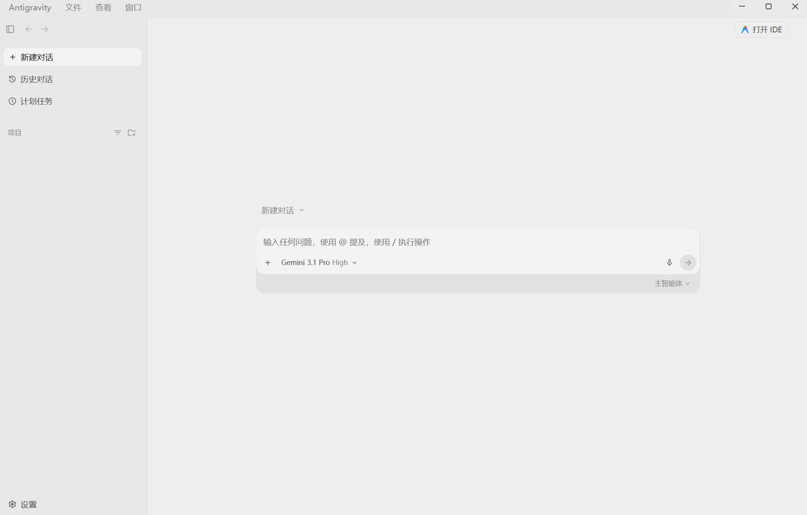

# Antigravity-zh-CN

<div align="center">

**🌏 English | [简体中文](README.md)**

An open-source Chinese localization patch for Google Antigravity Desktop

[](https://opensource.org/licenses/MIT)
[](https://www.python.org/downloads/)
[](https://www.microsoft.com/windows)

</div>

---

## 📖 Project Overview

**Antigravity Chinese Localization Patch** - Provides complete Chinese interface support for Google Antigravity Desktop (maintained on top of [MIMICTE/Antigravity-zh-CN](https://github.com/MIMICTE/Antigravity-zh-CN) under MIT License), with dynamic installation discovery and compatibility for Antigravity 2.33+/2.34+ while preserving official auto-updates.

## ✨ Key Features

- 🚀 **Zero Dependencies** - Built-in pure Python ASAR parser and packer using only standard libraries, no Node.js or npm required
- 🎯 **Chat-Zone Default Zero-Write & UI Slot Whitelist** - Uses persistent chat-pane host discovery and hard protection boundaries to enforce zero writes across user messages, bare/Markdown assistant replies, expanded thinking panels, artifact previews, code/terminal/math blocks, editable regions (including `contenteditable="plaintext-only"`), and form submission values; only allowlisted UI slots (app shell, Settings, step triggers, file summary bars, feedback row timestamps, dialog chrome) are updated via non-destructive `Text.data` and independent display attributes—zero `innerHTML` rewrites and no false positives on `2D`/`3D`/`1M`
- ⚡ **One-Click Deployment** - Automatically handles process cleanup and software restart for a seamless "press Enter → enjoy Chinese" experience
- 🛡️ **Clean & Reversible** - Complete removal of localization with restore script, ensuring "lossless rollback" to official English version at any time
- 🧭 **Cross-Platform Compatibility** - Automatically detects OS environment, natively supporting path resolution and process management on both Windows and macOS

## 📦 Download & Installation

### Option 1: Standalone Version (Windows / macOS) ⭐ Recommended for Most Users

**Download:** [Download your OS version from Releases](https://github.com/MIMICTE/Antigravity-zh-CN/releases/latest) (Supports Windows x64, macOS Intel/Apple Silicon)

**Features:**
- ✅ Ready to use, **no Python environment required**
- ✅ Native experience, one-click execution with automatic app restart

**【For Windows Users】**
1. Download `Antigravity-zh-CN-v2.21.1-windows-x64.zip` and extract
2. Double-click `Antigravity-Patcher.exe` to apply the patch (Use `Restore.exe` to revert)

**【For macOS Users】**
1. Download the corresponding macOS archive (`arm64` for M-series Apple Silicon, `x86_64` for Intel) and extract
2. Open Terminal, navigate to the extracted folder, grant execution permissions and run:
   ```bash
   chmod +x Antigravity-Patcher-macOS-*
   ./Antigravity-Patcher-macOS-*
   ```
> 🍎 **macOS Note**: If blocked by Gatekeeper ("cannot be opened because the developer cannot be verified"), go to "System Settings -> Privacy & Security", scroll down and click "Open Anyway". Alternatively, run `xattr -cr Antigravity-Patcher-macOS-*` in Terminal to clear attributes.

---

### Option 2: Install from Source ⭐ Recommended for Developers

**Clone the repository:**
```bash
git clone https://github.com/MIMICTE/Antigravity-zh-CN.git
cd Antigravity-zh-CN
python Antigravity-Patcher.py
```

**Or download source code archive:**

Download `Source code (zip)` or `Source code (tar.gz)` from [Releases page](https://github.com/MIMICTE/Antigravity-zh-CN/releases/latest), extract and run `Antigravity-Patcher.py`.

## 💡 Technical Approach

This project leverages Electron framework mechanisms:

### 1. Unpacked Patching
Disables the official `app.asar` file, forcing the software to read from the unpacked `app` folder with injected localization code.

### 2. Chat Content Is Read-Only by Default

The renderer verifies that a node belongs to a recognized UI slot before translating its `Text.data` or a display attribute. Messages, thinking panels, artifact previews, editors, and form values retain their original content. Thinking portals are protected by element identity, so a mounted panel stays protected after its trigger is removed.

The global observer handles structure and a limited set of attributes. Text observation is attached only to authorized UI nodes, and local attribute observers track application assignments while a translated node is detached. Initial discovery, bulk cleanup, and translation run across animation frames with a 4 ms target budget per frame. In the Chromium fixtures, in-place prose streaming generated zero localization observer records, and structured prose inserts made zero subtree queries.

### 3. Native ASAR Parser
Pure Python implementation of the ASAR file format parser with zero external dependencies, path-traversal protection, cross-process locking, and automatic rollback on failure.

### 4. Automated Tests
```bash
python -m unittest discover -s tests -v
```
Covers ASAR extraction, patch and restore, cross-process locking, dictionary keys, and pure text formatting. Install Node.js 22 or later and Chromium (such as Chrome or Edge) to run browser regressions for content writes, portal and node reuse, a 2,000-turn history, 2,000 text fragments, and 2,000 buttons at startup and on remount.

### 5. Maintenance and Packaging

- [Antigravity-Patcher.py](Antigravity-Patcher.py) handles installation, version changes, and injection. [Restore.py](Restore.py) handles restoration.
- [catalog.js](antigravity_localization/renderer/catalog.js) contains the dictionary. [formatters.js](antigravity_localization/renderer/formatters.js) handles durations, statuses, and other text patterns.
- [antigravity_dom.js](antigravity_localization/renderer/antigravity_dom.js) defines Antigravity's UI slots and protects content. [engine.js](antigravity_localization/renderer/engine.js) handles scheduling, writes, and node lifecycles.
- [mount_walk.js](antigravity_localization/renderer/mount_walk.js) resumes discovery across frames when nodes are removed. [portal_registry.js](antigravity_localization/renderer/portal_registry.js) tracks thinking panels by element identity and mutation order.
- [Antigravity-Patcher.spec](Antigravity-Patcher.spec) includes the renderer assets in the standalone binary. Run `uvx pyinstaller Antigravity-Patcher.spec` from the repository root.

## ⚠️ Known Limitations

- **Chat Prose & Thinking Logs Preserved Verbatim** - By design, user messages, assistant reply prose, expanded thinking logs, and artifact preview content are strictly zero-write to prevent tampering with code, technical tokens, or user data; only frontend UI chrome and verified control slots are localized
- **Platform Support** - Fully supports Windows and macOS (Intel & Apple Silicon). Linux is currently not supported
- **Version specific** — The current DOM adapter targets Antigravity 2.34. UI slots that change after an update retain their original text until recognized.

## 📸 Screenshots

<div align="center">



*Example of the localized Antigravity interface*

</div>

**Examples of localized UI**
- ✅ Sidebar menu (New conversation, History, Scheduled tasks, Projects)
- ✅ Top navigation bar (File, Audio, Window)
- ✅ Input placeholder text and model selector
- ✅ Supported options and descriptions in Settings
- ✅ Underlying terminal permission request prompts and dynamic status text

> 💡 Tip: To see the actual result, simply double-click `Antigravity-Patcher.exe` or `Antigravity-Patcher.py` to experience the complete Chinese interface!

## 🔐 Security

This project is completely open-source and secure:

### ✅ What We Do

- **UI Text Only** - Only replaces display text at the frontend level, no network interception, data collection, or account access
- **Open Source** - All code is fully open-source with no obfuscation, encryption, or hidden logic
- **Reversible** - Complete restore mechanism, one-click rollback to original version
- **Zero External Dependencies** - Pure Python standard library implementation, no external server connections

### 🛡️ How It Works

1. **ASAR Unpacking** - Pure Python parser for Electron's ASAR package format
2. **Code Injection** - Append translation code to `preload.js` and `menu.js`
3. **DOM Monitoring** - Use `MutationObserver` to watch page changes
4. **Text Replacement** - Dictionary-based English to Chinese text replacement

### About the Standalone Executables (Windows .exe / macOS binaries)

- Packaged using [PyInstaller](https://pyinstaller.org/) open-source tool
- Contains complete Python runtime environment (hence file size ~8 MB)
- May be flagged by some antivirus software on Windows, which is a known PyInstaller issue
- macOS may show "cannot be opened because the developer cannot be verified" due to lack of paid Apple Developer signature
- If you have security concerns, use the "Install from Source" method (completely transparent code)

No reverse engineering or cracking involved.

## ❓ FAQ

<details>
<summary><b>Q: macOS version shows "cannot be opened because the developer cannot be verified"?</b></summary>

A: This is triggered by macOS Gatekeeper (because this open-source tool is not signed with a paid Apple Developer certificate). To fix this:
1. Option 1: Go to "System Settings -> Privacy & Security", scroll down and click "Open Anyway".
2. Option 2: Run `xattr -cr /path/to/downloaded/file` in Terminal to clear quarantine attributes.
</details>

<details>
<summary><b>Q: What's the difference between Python script and standalone versions?</b></summary>

A: 
- **Python script version**: Requires Python environment, small size, transparent code
- **Standalone version**: No Python needed, ready to use, but larger file size and may trigger false positives

Both versions have identical functionality. Choose based on your needs.
</details>

<details>
<summary><b>Q: Why is the .exe file so large?</b></summary>

A: The .exe file includes the complete Python runtime environment, so ~8 MB is normal.
</details>

<details>
<summary><b>Q: Antivirus flagging as virus?</b></summary>

A: This is a known PyInstaller issue, not an actual virus. You can:
- Add to antivirus whitelist
- Use Python script version instead (recommended)
- Upload to [VirusTotal](https://www.virustotal.com/) for verification
</details>

<details>
<summary><b>Q: "Python is not recognized as an internal or external command"?</b></summary>

A: Python is not added to your system PATH. Reinstall Python and make sure to check "Add Python to PATH" during installation, or use the standalone `.exe` version instead.
</details>

<details>
<summary><b>Q: Why does Antigravity sometimes open without a visible UI? Is the software broken by the script?</b></summary>

A: Usually, this is not caused by the script, but by Electron's background process mechanics:
1. The app might have started minimized to the **System Tray**. Check your tray icon (often a black `^` icon) and double-click it to bring up the window.
2. There might be a "zombie" `Antigravity.exe` background process left in the Task Manager. Press `Ctrl+Shift+Esc` to end all Antigravity processes in the Task Manager and try opening it again.
3. If it's a completely blank screen, your antivirus might have quarantined essential unpacked code files. Run `Restore.exe` to revert to the official version, temporarily disable the antivirus, and re-run the patcher to revive it.
</details>

<details>
<summary><b>Q: Can I still use this localization patch when the official Antigravity app updates?</b></summary>

A: **Absolutely!** 
Rerun the patcher after updating the client. It detects changes to the official bundle and extracts and patches the installed version. If the updated interface shows untranslated UI, the DOM adapter can be extended with the corresponding verified slots.
</details>

<details>
<summary><b>Q: Does this patch affect software security?</b></summary>

A: No. This patch only modifies UI text display and does not involve network communication, data encryption, account authentication, or core functionality. All changes are at the frontend level and do not affect communication with servers.
</details>

<details>
<summary><b>Q: How to add new translations?</b></summary>

A: Add key-value pairs to the `dictionary` in [catalog.js](antigravity_localization/renderer/catalog.js).
```javascript
"English Text": "中文翻译",
```
Then re-run the patch script.
</details>

<details>
<summary><b>Q: Does it support other operating systems?</b></summary>

A: Currently Windows only. macOS and Linux versions have different paths and mechanisms that require separate adaptation.
</details>

More questions? Welcome to ask in [GitHub Issues](../../issues) or [Discussions](../../discussions)!

## 🤝 Contributing

Issues and Pull Requests are welcome!

- Found translation errors or omissions? Submit an [Issue](../../issues) or PR
- Have better technical solutions? Discuss in [Discussions](../../discussions)

For detailed contribution guidelines, see [CONTRIBUTING.md](CONTRIBUTING.md)

## 📄 License

This project is licensed under the [MIT License](LICENSE).

## ⚠️ Disclaimer

- This project is for educational purposes only
- Users are responsible for any issues arising from using this patch
- Please use official licensed Antigravity software
- Please comply with Antigravity's Terms of Service

## 🌟 Star History

If this project helps you, please consider giving it a star ⭐️

## 📧 Contact

- Issues: [GitHub Issues](../../issues)
- Discussions: [GitHub Discussions](../../discussions)

---

<div align="center">

**Made with ❤️ by Antigravity-zh-CN Contributors**

</div>
